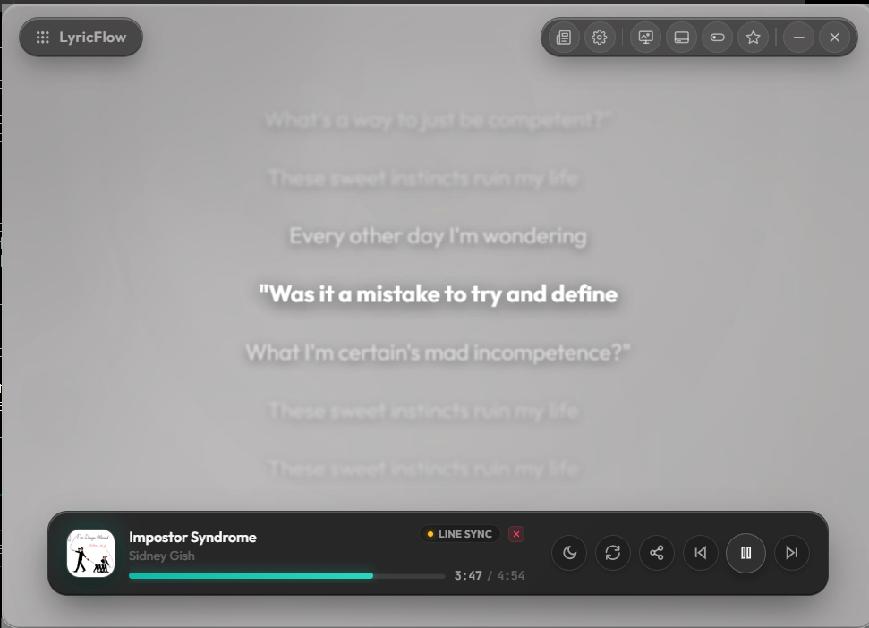
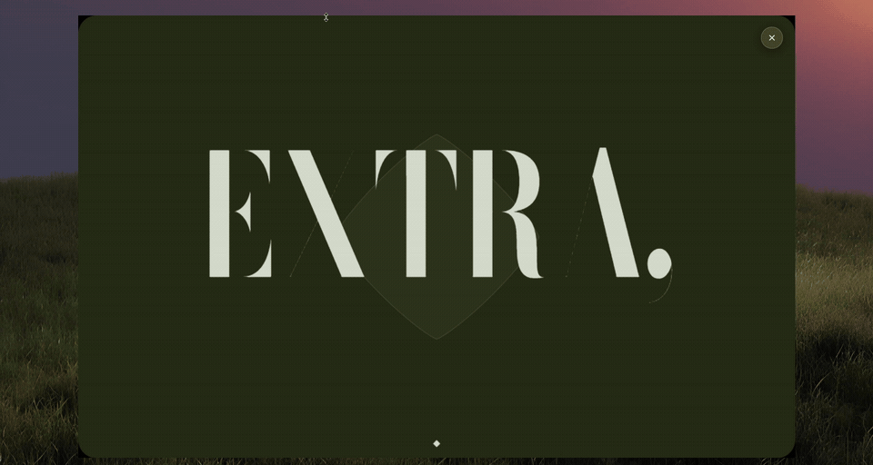
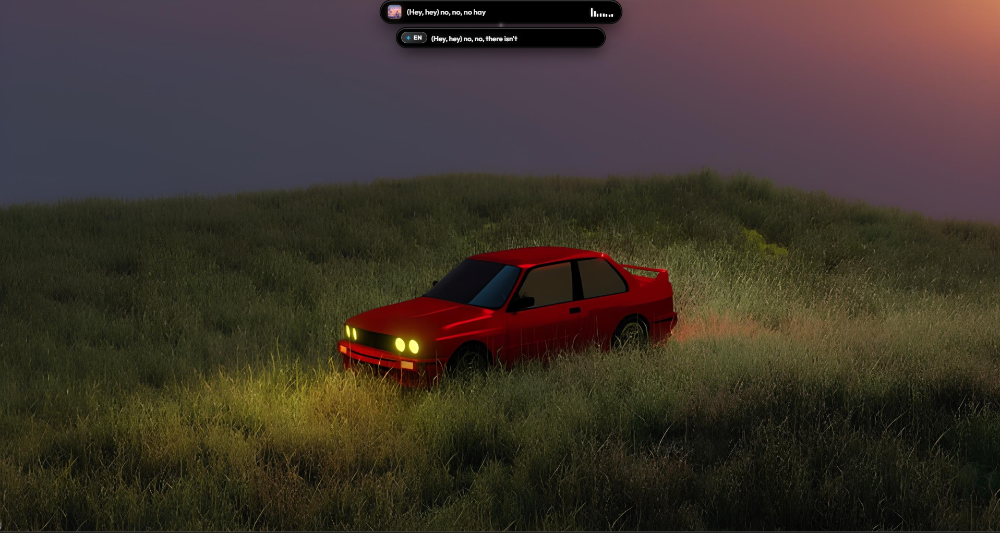
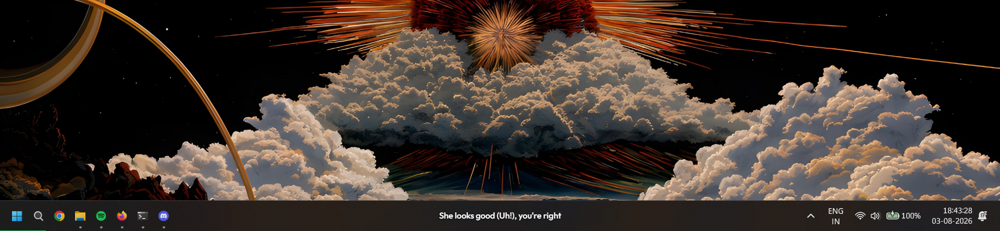
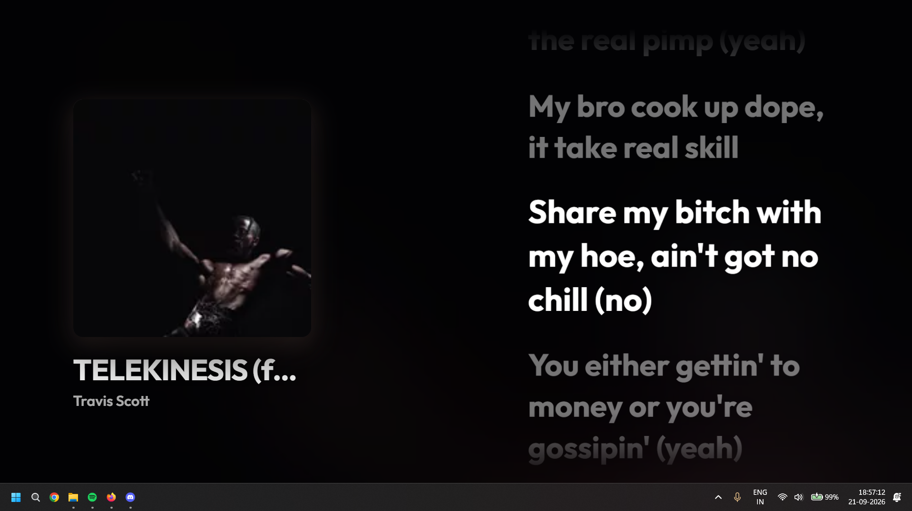
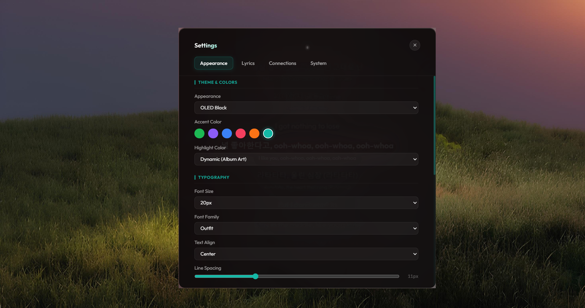
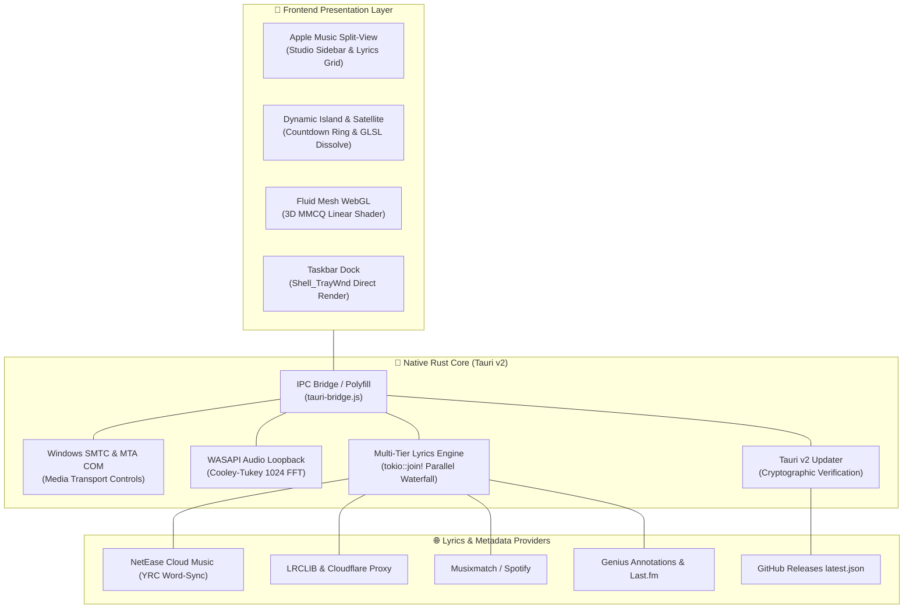

<div align="center">
  
  <h1>LyricFlow</h1>
  <p><strong>A breathtaking, ultra-lightweight desktop lyrics overlay with real-time word synchronization, Dynamic Island, and adaptive ambient aesthetics.</strong></p>
  <p><i>Engineered in native Rust (Tauri v2) for sub-30 MB RAM usage, instant responsiveness, and cross-platform performance.</i></p>
  
  <p>
    <a href="https://github.com/badghost001/LyricFlow/releases/latest"></a>
    <a href="https://github.com/badghost001/LyricFlow/releases"></a>
    <a href="https://v2.tauri.app/"></a>
    <a href="https://www.rust-lang.org/"></a>
    <a href="https://github.com/badghost001/LyricFlow/blob/main/LICENSE"></a>
    <a href="https://github.com/badghost001/LyricFlow/blob/main/LICENSE"></a>
  </p>

  <p>
    <a href="#-whats-new-in-v1440">What's New</a> •
    <a href="#-key-features">Features</a> •
    <a href="#-showcase--screenshots">Showcase</a> •
    <a href="#-keyboard-shortcuts">Shortcuts</a> •
    <a href="#-installation">Installation</a> •
    <a href="#-building-from-source">Build from Source</a> •
    <a href="#-architecture--tech-stack">Tech Stack</a>
  </p>
</div>

---

## 🌟 What's New in v1.44.0

### 🎵 Apple Music Desktop Studio & Split-View
- **Apple HIG Split-View Layout:** Dedicated left-hand studio sidebar featuring high-resolution album artwork, track title, artist, album metadata, and integrated glassmorphic playback controls paired with right-hand smooth-scrolling synchronized lyrics.
- **Interactive Inline Scrubber:** Seamless Apple Music-style progress bar with draggable scrub thumb, micro-hover expand states, and instant millisecond seeking.
- **Click-to-Expand Album Art:** Tap the album artwork in Split-View to reveal a full-resolution modal preview with fluid backdrop blur.
- **Adaptive MMCQ Ambient Glass:** Real-time 3D color extraction generating a synchronized 5-tier fluid glass background tailored specifically to the current album cover.

### 🏝️ Dynamic Island Evolution Suite
- **Apple-Style Circular Countdown Ring:** Smooth 360° to 0° radial progress ring that winds down during track intros and instrumental interludes, indicating exactly when vocals resume.
- **Liquid Specular Halo & Beat Pulse:** Audio-reactive specular rim lighting and subtle kick-reactive physics pulsing directly with the song's bassline.
- **Integrated Micro-HUD & Gestures:** Tactile squircle playback toggles with instant double-click play/pause gestures and mouse-wheel volume adjustment.
- **Lossless Audio & Quality Micro-Badges:** Dynamic indicators for `LOSSLESS`, `HI-RES`, `ATMOS`, `WORD-SYNC`, and `LINE-SYNC`.
- **Free-Floating Draggable Mode & Magnetic Edge Snapping:** Drag the Dynamic Island freely across monitors with magnetic snapping to screen edges and persistent coordinate memory across app restarts.
- **WebGL Particle Disintegration:** High-performance GLSL disintegration shader with drifting ash particles and smooth opacity fade when the island enters sleep mode.
- **Overseas NetEase YRC Prioritization:** Dedicated fetch budget for NetEase word-by-word karaoke lyrics with automatic overseas endpoint resolution.

### 🌊 Real-Time Audio Visualizer & Instrumental Interlude Halt
- **Zero-Drop WASAPI Visualizer:** Continuous loopback audio spectrum visualizer (1024-point FFT) that remains resilient across track switches, device changes, and pauses.
- **Smart Instrumental Break Halt:** During guitar solos and instrumental interludes, the lyrics view smoothly halts at the current lyric line instead of jarringly resetting to the top of the song.
- **Vibrant Active Word Illumination:** Syllable-by-syllable karaoke words illuminate in crisp, pure white against smoothly dimmed preceding and upcoming lyrics.

### ⚡ Zero-Drift Timing & Desync Elimination
- **Sub-Millisecond Syllable Duration Normalization:** Solved timing desync stalls caused by millisecond vs. second confusion on short plosive syllables (<40ms).
- **Defensive Line Bounding:** Enforced strict vocal onset boundaries preventing any lyric provider from overflowing word durations past the start of the next line.

### 🛡️ Storage Resilience & Distraction-Free UX
- **Intelligent Storage Quota Pruning:** Automatically detects and purges stale base64 data URLs, Genius annotations, and cached art to prevent `QuotaExceededError` storage crashes.
- **Universal Right-Click Suppression:** Comprehensive capture-phase context menu lockout across all app windows, ensuring a pristine native application experience.

---

## ✨ Key Features

### 🏝️ Dynamic Island with Dual Connected Satellite
- **Adaptive Docking Pill:** Floats seamlessly at the top of your screen, displaying current line lyrics, track progress, and album artwork.
- **Dual Connected Satellite Island:** Docks adjacent or below the main island to display real-time line-by-line foreign language translations.
- **Smart Language Detection:** Automatically suppresses redundant translations when lyrics are in English/native languages, smoothly expanding into view only when foreign phrases appear.
- **Inactivity Sleep & WebGL Disintegration:** Auto-sleeps after customizable idle timeouts (30s, 1m, 2m, 5m, or Never) with GPU-accelerated particle dispersion shaders.
- **Integrated Audio Visualizer:** High-performance WASAPI loopback audio reactive frequency bars pulsing directly within the island.

### 🦀 High-Speed Multi-Tier Rust Lyrics Engine
- **Asynchronous Parallel Fetching:** Simultaneously queries **NetEase Cloud Music (YRC word-sync)**, **LRCLIB**, **Cloudflare Proxy**, and **Musixmatch** using `tokio::join!`. Runs in native Rust with zero browser CORS constraints.
- **Smart Waterfall Fallbacks:** Seamless cascade from Word-Synced Karaoke (`WORD_SYNCED`) → Line-Synced (`LINE_SYNCED`) → Plain Text (`PLAIN_TEXT`), backed by Spotify Color-Lyrics, Apple Music, and Genius.
- **Syllable-by-Syllable Karaoke Timing:** Word-level glow highlights following the artist's vocal cadence in real time.
- **Zero-Drift PI-PLL Clock:** Dual-tier phase-locked loop clock with clock slew interpolation eliminating jitter and desync when seeking, skipping tracks, or resuming playback.

### 🎨 3D MMCQ Ambient Canvas & Glow Engine
- **Modified Median Cut Quantization (MMCQ):** Extracts a synchronized 5-tier color palette (`dominant`, `secondary`, `accent`, `highlight`, `background`) in ~1.6ms with zero synthetic hue offsets.
- **Fluid Mesh WebGL Shader:** Gamma-corrected linear color blending (`pow(c, 2.2)`) with specular sheen crests that match the mood of the album cover.
- **Screen Edge Glow:** Optional peripheral ambient screen border lighting synchronized to the rhythm and color palette of the playing song.
- **Pure White Legibility:** Word and line highlights locked to crisp white typography with dynamic ambient artwork aura.

### 🪟 Flexible Display Modes
- **Apple Music Desktop Studio:** Split-view layout with left-hand metadata and right-hand smooth-scrolling synchronized lyrics.
- **Floating Glassmorphic Window:** Resizable, draggable frosted-glass window with adjustable background blur, font size, and layout scaling.
- **Windows Taskbar Mode:** Docks single-line synced lyrics directly into the Windows Taskbar (`Shell_TrayWnd`) with sub-millisecond cursor hit-testing and continuous topmost z-order preservation.
- **Ambient Wallpaper & Fullscreen:** Immersive full-screen visualizer mode featuring Apple Music-style blurred artwork pan animations, dynamic kinetic typography, and looping Spotify Canvas MP4 playback.

### 📸 Lyric Share Card Studio
- **Multi-Format Social Presets:** Generate visually stunning lyric cards in **Instagram Story (9:16)**, **Square (1:1)**, **Portrait Feed (4:5)**, and **Landscape (16:9)**.
- **Curated Typography Stacks:** Switch between Modern Sans, Editorial Serif, Monospace, and Soft Rounded font stacks.
- **Multi-Mode Lyrics Rendering:** Original lyrics, Bilingual (Original + Translation), or Translation-only view with instant clipboard copying and PNG saving.

### 📻 Deep Native OS Integrations
- **Windows:** System Media Transport Controls (SMTC) via dedicated MTA COM worker thread—supporting Spotify Desktop, Apple Music, YouTube Music Desktop, web browsers, Tidal, Deezer, and local media players.
- **macOS:** AppleScript IPC for Spotify and Apple Music (`Music.app`).
- **High-Res Artwork Upscaling:** Automatically detects and replaces low-resolution media transport thumbnails with pristine 600×600 artwork from iTunes and Deezer APIs.
- **Genius Facts & Last.fm:** Real-time song annotations, trivia pills, and automatic Last.fm scrobbling.

---

## 📸 Showcase & Screenshots

<div align="center">

### 🎵 Apple Music Desktop Studio (Split-View)
*Left-side high-resolution artwork and metadata card paired with right-side smooth scrolling synchronized lyrics and progressive karaoke highlights.*
<br/>


<br/><br/>

### 🎬 Immersive Kinetic & Cinematic Live Mode
*Dynamic word-by-word karaoke typography, 7 parametric shape morph transitions, and zero-latency acoustic audio tracking.*
<br/>


<br/><br/>

### 🏝️ Dynamic Island with Dual-Connected Satellite Translation
*Floating pill with live WASAPI audio visualizer, circular countdown arc, and docked real-time bilingual translation satellite.*
<br/>


<br/><br/>

### 🪟 Windows Taskbar Dock Mode
*Unobtrusive single-line lyrics ticker docked directly into the Windows Taskbar with zero interference to tray icons.*
<br/>


<br/><br/>

### 🌄 Ambient Wallpaper / Fullscreen Mode
*Fluid typography, animated canvas backgrounds, and Spotify Canvas MP4 loops.*
<br/>


<br/><br/>

### ⚙️ Settings & Aesthetics Studio
*Deep personalization: Themes (Dark Glass, OLED Black, Pearl Light), Cinematic Stage vs. Classic Scrolling toggle, custom accents, and typography controls.*
<br/>


</div>

---

## ⌨️ Keyboard Shortcuts

| Shortcut | Action | Description |
| :--- | :--- | :--- |
| <kbd>Ctrl</kbd> + <kbd>Shift</kbd> + <kbd>L</kbd> | **Toggle Click-Through** | Makes overlay transparent to clicks (pass-through for gaming/work) |
| <kbd>Ctrl</kbd> + <kbd>Shift</kbd> + <kbd>C</kbd> | **Copy Active Lyric** | Copies current playing lyric line to clipboard |
| <kbd>Ctrl</kbd> + <kbd>Shift</kbd> + <kbd>S</kbd> | **Share Lyric** | Opens the lyric share card studio dialog |
| <kbd>Ctrl</kbd> + <kbd>Shift</kbd> + <kbd>Arrows</kbd> | **Nudge Overlay** | Fine-tunes the window position by 2px in any direction |
| <kbd>Ctrl</kbd> + <kbd>[</kbd> / <kbd>]</kbd> | **Adjust Sync Offset** | Shifts lyric timing earlier/later by 50ms |
| <kbd>Ctrl</kbd> + <kbd>0</kbd> | **Reset Sync** | Resets song-specific timing offset to zero |
| <kbd>Ctrl</kbd> + <kbd>R</kbd> | **Alternative Lyrics** | Cycles or chooses alternative lyrics candidates |
| <kbd>Ctrl</kbd> + <kbd>Alt</kbd> + <kbd>Space</kbd> | **Play / Pause** | Toggles playback across active media player |
| <kbd>Ctrl</kbd> + <kbd>Alt</kbd> + <kbd>→</kbd> | **Next Track** | Skips to the next song |
| <kbd>Ctrl</kbd> + <kbd>Alt</kbd> + <kbd>←</kbd> | **Previous Track** | Returns to the previous song |

---

## 📦 Installation

### ⚡ Fast Install (Recommended for Windows)

The easiest way to install or update LyricFlow without browser security warnings is directly through **PowerShell** or **Windows Terminal**:

```powershell
irm https://raw.githubusercontent.com/badghost001/LyricFlow/main/install.ps1 | iex
```

> **What this does:** Fetches the latest release, installs it silently to your user profile, creates Start Menu & Desktop shortcuts, and auto-launches the app. Run the same command anytime to update!

---

### 🪟 Windows Package Manager (`winget`)

```powershell
winget install badghost.LyricFlow
```

---

### 💾 Manual Direct Downloads

Download the latest release directly from the **[Releases](https://github.com/badghost001/LyricFlow/releases/latest)** page:

#### 🪟 Windows
- **NSIS Setup Installer:** [`LyricFlow_x64-setup.exe`](https://github.com/badghost001/LyricFlow/releases/latest)
  - Installs for current user, creates Start Menu and Desktop shortcuts, supports seamless auto-update.
- **Windows MSI Package:** [`LyricFlow_x64_en-US.msi`](https://github.com/badghost001/LyricFlow/releases/latest)
  - Standard Windows Installer package.

> 🛡️ **Note on Windows SmartScreen:**  
> If you download the `.exe` directly in your browser and Windows displays *"Windows protected your PC"*, simply click **"More info"** ➔ **"Run anyway"**.  
> This standard Defender dialog appears for all new independent software without expensive enterprise certificates. LyricFlow is 100% clean, safe, and privacy-focused.

#### 🍏 macOS
- **Universal DMG Installer:** [`LyricFlow_universal.dmg`](https://github.com/badghost001/LyricFlow/releases/latest)
  - Universal binary running natively on both **Apple Silicon (M1/M2/M3/M4)** and **Intel** Macs.
  - Open the DMG and drag `LyricFlow.app` into your `Applications` folder.

#### 🐧 Linux
- **Standalone AppImage:** [`LyricFlow_amd64.AppImage`](https://github.com/badghost001/LyricFlow/releases/latest)
  - Make executable (`chmod +x LyricFlow_amd64.AppImage`) and launch directly on any modern distribution.
- **Debian / Ubuntu Package:** [`LyricFlow_amd64.deb`](https://github.com/badghost001/LyricFlow/releases/latest)
  - Install via `sudo dpkg -i LyricFlow_amd64.deb` or Software Center.

---

## 🛠️ Building from Source

### Prerequisites
1. **Node.js 20+** and `npm`
2. **Rust stable toolchain** (1.80+):
   ```bash
   rustup default stable
   ```
3. **Platform-specific build dependencies:**
   - **Windows:** Visual Studio 2022 Build Tools (Desktop development with C++).
   - **Linux (Ubuntu/Debian):**
     ```bash
     sudo apt-get update && sudo apt-get install -y libwebkit2gtk-4.1-dev libappindicator3-dev librsvg2-dev patchelf
     ```
   - **macOS:** Xcode Command Line Tools (`xcode-select --install`).

### Build Steps

```bash
# 1. Clone repository
git clone https://github.com/badghost001/LyricFlow.git
cd LyricFlow

# 2. Run unit tests
npm test

# 3. Launch in development mode
npm run tauri:dev

# 4. Compile optimized release bundles
npm run tauri:build
```

Compiled binaries and distribution installers will be generated under `src-tauri/target/release/bundle/`.

---

## 🔬 Architecture & Tech Stack



- **Runtime:** [Tauri v2](https://v2.tauri.app/) + [Rust](https://www.rust-lang.org/) (Static binary, memory footprint ~20–30 MB).
- **Color Engine:** 3D Modified Median Cut Quantization (MMCQ) in 5-bit RGB space with specular sheen cresting.
- **Audio DSP:** Real-time 1024-point Cooley-Tukey Radix-2 FFT via Windows WASAPI loopback capture.
- **Clock Synchronization:** Dual-tier Proportional-Integral Phase-Locked Loop (PI-PLL) with sub-frame clock slew interpolation.

---

## 🤝 Contributing

Contributions, bug reports, and suggestions are warmly welcomed!
- Check out the [Issues](https://github.com/badghost001/LyricFlow/issues) page to report bugs or request features.
- Pull requests for additional lyric providers, translations, or UI enhancements are always appreciated.

---

## 🎉 Community & Special Thanks

A huge shoutout to the community over at **[BHABHI KI कुटिया](https://discord.gg/bhabhi)** for continuous testing, feedback, and creative ideas!

---

## 📝 License

This project is licensed under a Proprietary License (All Rights Reserved). See the [LICENSE](LICENSE) file for full details.

<div align="center">
  <i>Crafted with ❤️ by <a href="https://github.com/badghost001">badghost</a></i>
</div>
