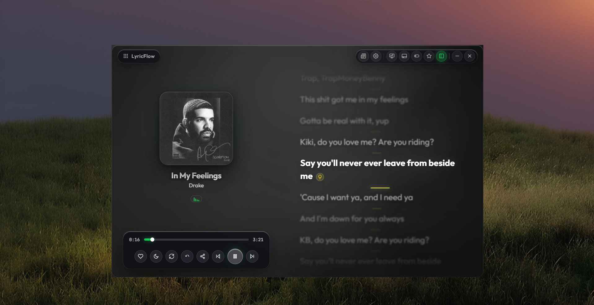
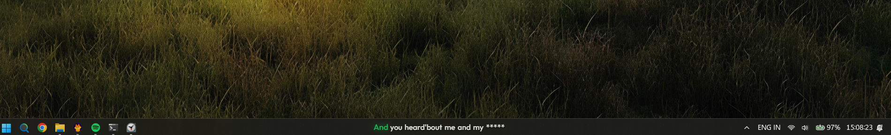
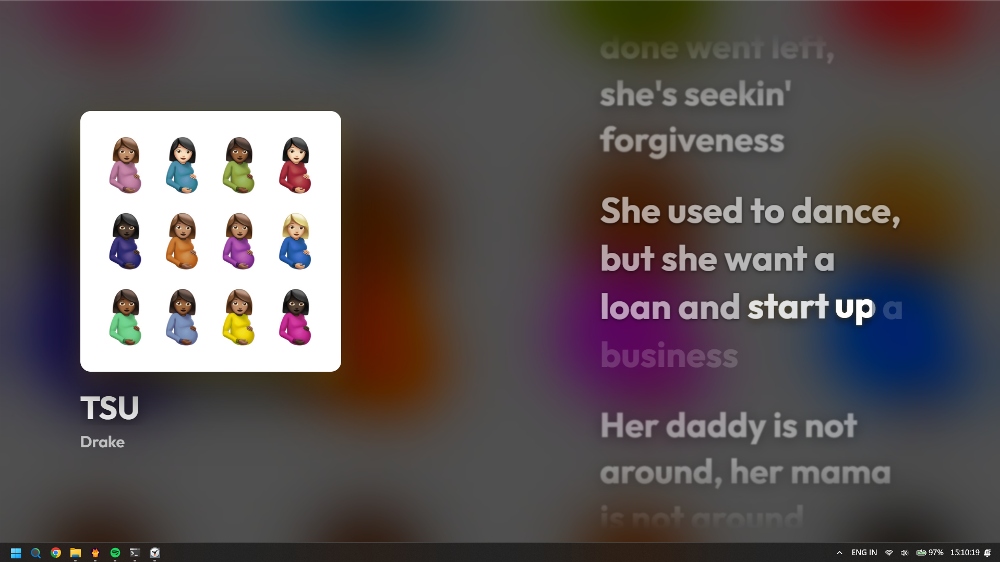
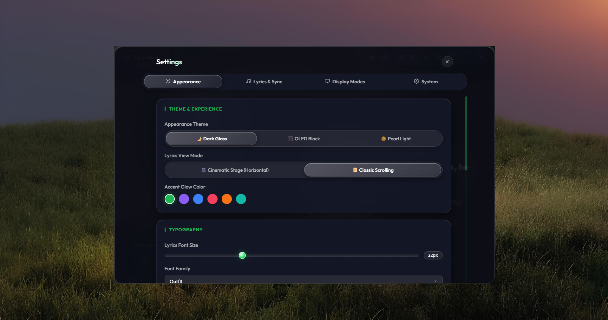
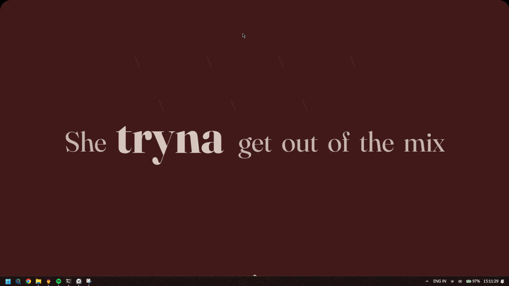
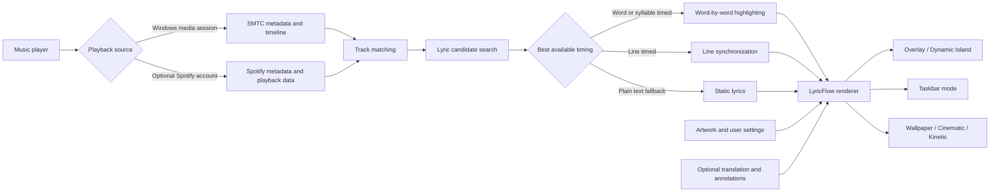

# LyricFlow

LyricFlow is a desktop companion for live music playback. It finds synchronized lyrics, follows the song timeline, and presents lyrics and playback information in a floating window, Dynamic Island, taskbar dock, or desktop view.

> **Current project version:** 1.44.3. For the newest installers, use [GitHub Releases](https://github.com/badghost001/LyricFlow/releases/latest).

LyricFlow does not play or stream music. It reads playback information from a supported player or Windows media session and retrieves lyrics and artwork over the internet.

## What LyricFlow offers

### Lyrics and synchronization

- Automatically searches multiple lyric sources, including NetEase, LRCLIB, Musixmatch, and Spotify lyric data when available.
- Prefers word or syllable timed lyrics when a matching candidate is available, with line-synchronized and plain-text fallbacks.
- Lets you search, refresh, and cycle through alternate lyric candidates. Available candidates and timing vary by song and provider.
- Supports translations, bilingual display, and a separate translation capsule in Dynamic Island mode.
- Displays lyric annotations and song facts when those services return matching data.
- Handles duet and backing-vocal lines, instrumental sections, and provider-supplied lyric metadata where available.

### Playback and music information

- Reads compatible Windows playback sessions through Windows System Media Transport Controls (SMTC); Spotify sign-in is optional for local session detection.
- Offers optional Spotify account integration for Spotify-specific metadata and playback features.
- Displays track title, artist, album artwork, playback position, and duration when the player supplies them.
- Provides playback controls and global keyboard shortcuts. Shortcuts can be changed in Settings.
- Extracts album-art colors for themes, visualizers, and background effects.
- Includes audio-reactive visualizers, album-art transitions, and an optional Discord Rich Presence integration.

Player integration depends on whether the player publishes a usable system media session. Browser playback may expose less reliable timeline information than a desktop music app.

### Display modes

- **Standard overlay:** floating lyrics and compact playback controls.
- **Dynamic Island:** a compact capsule with artwork, live lyrics, playback controls, visualizer, translation, and next-track previews.
- **Taskbar mode:** a compact lyric display docked to the Windows taskbar.
- **Wallpaper mode:** lyrics and artwork presented across the desktop, with configurable layout and visual effects.
- **Cinematic and Kinetic modes:** larger lyric-focused presentations with animated typography and effects.

Modes can be switched from the app, Settings, or configured shortcuts. Some modes and integrations are platform-specific.

### Appearance and sharing

- Dark Glass, OLED Black, and Pearl Light appearance themes.
- Album-art color mesh, custom backgrounds, blur, accent colors, typography, and layout controls.
- Reduced-motion settings for supported animations and effects.
- Lyric Share Card editor with layout, theme, text, artwork, and export customization.
- Kinetic lyric video export options where supported by the selected design and local media tools.
- Track-sharing actions for supported music services when a direct track link can be resolved.

## Screenshots

### Main window



### Display modes

| Dynamic Island | Taskbar mode |
| --- | --- |
|  |  |



### Settings



### Kinetic lyrics



## System requirements

### Using LyricFlow

- **Windows:** Windows 10 or 11, 64-bit. The Windows app uses the Microsoft Edge WebView2 runtime, which is included with most current Windows installations.
- **macOS and Linux:** release packages may be provided through GitHub Releases. Feature availability differs by platform; Windows-specific SMTC, taskbar, and wallpaper integrations are not available everywhere.
- **Network:** required for lyric lookup, artwork lookup, translation, updates, and online integrations. Previously loaded local settings remain on the device.
- **Music source:** a player that publishes track metadata and a playback timeline gives the best synchronization. Spotify login is optional for Windows SMTC playback detection.

No dedicated GPU is required. Visual effects depend on the graphics capabilities of the system and can be reduced in Settings.

### Building from source

- Node.js 20 or newer and npm.
- Rust stable toolchain.
- **Windows:** MSVC C++ build tools and the WebView2 runtime.
- **Linux:** Tauri's Linux prerequisites, including WebKitGTK 4.1 development libraries, AppIndicator, librsvg, and `patchelf`.
- **macOS:** Xcode Command Line Tools; universal builds also require the Apple Silicon and Intel Rust targets.

See the official [Tauri prerequisites](https://v2.tauri.app/start/prerequisites/) for platform setup details.

## Installation

### 1. GitHub release installers

Open [LyricFlow Releases](https://github.com/badghost001/LyricFlow/releases/latest), download the package for your operating system, then follow that platform's installer prompts. Release assets are produced for Windows, macOS, and Linux; the available file types depend on the release. Windows builds use an NSIS setup installer.

### 2. Winget (Windows)

The repository includes a Winget manifest for `badghost.LyricFlow`. If that manifest version is available in your configured Winget source, install it with:

```powershell
winget install --id badghost.LyricFlow --exact
```

The manifest currently checked into this repository is version **1.40.5**, which may lag behind the latest release and may not yet be present in the public Winget source. Check package availability and the version Winget will install with:

```powershell
winget show --id badghost.LyricFlow --exact
```

Use the GitHub release installer or the PowerShell installer below when you need the newest version.

### 3. PowerShell installer (Windows)

The repository's `install.ps1` downloads the latest Windows x64 setup installer from GitHub Releases and runs it. To run it directly from the repository:

```powershell
irm https://raw.githubusercontent.com/badghost001/LyricFlow/main/install.ps1 | iex
```

For an interactive installer, download the script and pass `-Interactive`:

```powershell
Invoke-WebRequest https://raw.githubusercontent.com/badghost001/LyricFlow/main/install.ps1 -OutFile install.ps1
./install.ps1 -Interactive
```

The script also accepts `-NoLaunch` to finish installation without launching LyricFlow. Re-running the installer updates an existing installation.

### 4. Build and run from source

```powershell
git clone https://github.com/badghost001/LyricFlow.git
cd LyricFlow
npm install
npm run tauri:dev
```

Build a distributable Tauri package with:

```powershell
npm run tauri:build
```

The repository also retains an Electron compatibility shell:

```powershell
npm start
npm run build:win
```

Tauri is the primary application and release path. Electron scripts are retained for compatibility and Windows packaging workflows.

### Updating

The Tauri app checks the configured GitHub release endpoint for signed over-the-air updates. You can also install a newer release manually using its platform installer. The PowerShell installer is another Windows update path.

## Workflow



## Keyboard shortcuts

Default global shortcuts on Windows include:

| Shortcut | Action |
| --- | --- |
| `Ctrl+Shift+C` | Toggle Cinematic mode |
| `Ctrl+Shift+S` | Open Share Card Studio |
| `Ctrl+Shift+D` | Toggle Dynamic Island |
| `Ctrl+Shift+K` | Toggle Kinetic mode |
| `Ctrl+Shift+W` | Toggle Wallpaper mode |
| `Ctrl+Shift+B` | Toggle Taskbar mode |
| `Ctrl+Alt+C` | Copy the active lyric |
| `Ctrl+Alt+Space` | Play or pause |
| `Ctrl+Alt+Left` / `Ctrl+Alt+Right` | Previous / next track |

Additional actions and shortcut editing are available in Settings. Shortcuts can conflict with other applications or system hotkeys.

## Development and checks

Run the JavaScript test suite:

```powershell
npm test
```

Run the Rust library tests:

```powershell
cargo test --manifest-path src-tauri/Cargo.toml --lib
```

GitHub Actions builds release packages for Windows, Linux, and macOS when configured release branches or tags are pushed.

## Repository layout

- `src/` — application interface, renderer, styles, and JavaScript modules.
- `src-tauri/` — Tauri application, Rust commands, lyric providers, and media integrations.
- `tests/` — JavaScript tests and rendering checks.
- `docs/screenshots/` — README screenshots and animated demonstration.
- `winget-manifests/` — Winget package manifests.
- `install.ps1` — Windows release installer and updater script.
- `.github/workflows/` — CI and cross-platform release builds.
- `main.js`, `preload*.js` — Electron compatibility shell.

## Troubleshooting

- **No playback detected:** start playback in a desktop player that publishes a Windows media session. Some browser and player sessions omit track position or metadata.
- **Lyrics do not appear or are not word-synced:** try another lyric candidate or refetch. Provider matching and word timing are not available for every track.
- **Translation or artwork is missing:** check network access; these services require an internet connection and may not have data for every song.
- **Tauri does not launch:** check the platform prerequisites and runtime requirements above.
- **A Winget version looks old:** compare it with GitHub Releases; the checked-in manifest can be updated separately from the app release.

## License

LyricFlow is distributed under the proprietary terms in [LICENSE](LICENSE). Do not redistribute or modify the software outside the permissions granted by that license.
