<p align="center">
  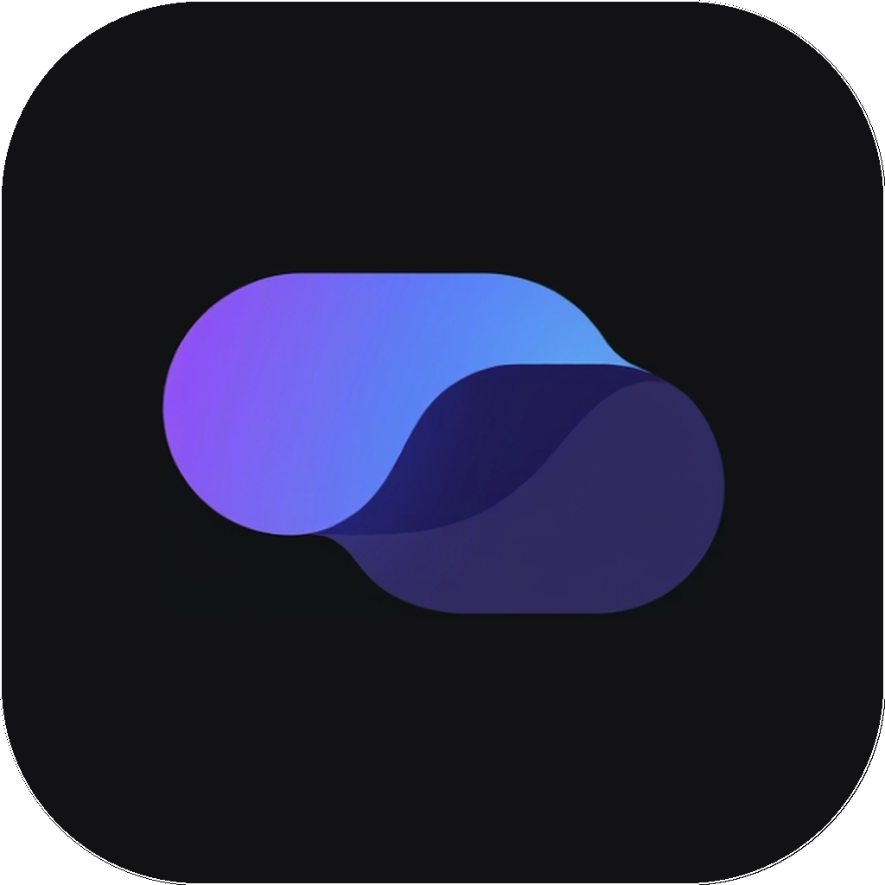
</p>

<h1 align="center">LyricFlow</h1>

<p align="center">
  <strong>Next-Generation Live Desktop Lyrics & Music Companion with Syllable & Word-by-Word Synchronization</strong>
</p>

<p align="center">
  <a href="https://github.com/badghost001/LyricFlow/releases/latest"></a>
  
  
  
  
</p>

<p align="center">
  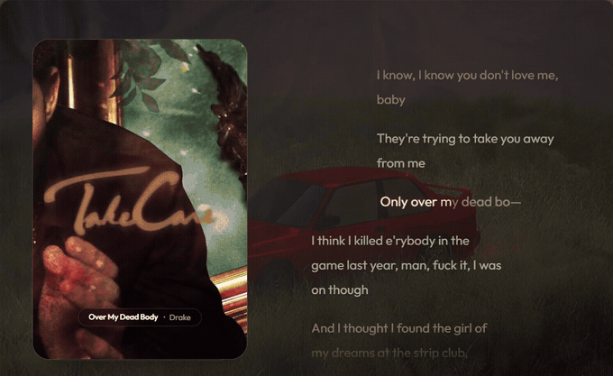
</p>

---

## What LyricFlow Does

**LyricFlow** is an intelligent desktop companion designed for music lovers. It automatically detects your active playback session, finds high-precision time-synced lyrics down to the syllable, and presents them in a fluid, audio-reactive interface crafted for every desktop setup.

Instead of playing audio directly, LyricFlow reads timeline information from your favorite media player or browser session and matches it against an advanced multi-provider lyrics waterfall in real time.

* **Universal Music Tracking**: Seamlessly connects to Windows System Media Transport Controls (SMTC). Works instantly with Spotify, Apple Music, Tidal, YouTube Music, Amazon Music, VLC, Foobar2000, and all modern Chromium/Gecko browsers without requiring user logins.
* **Syllable-Accurate Karaoke**: Highlights every word and syllable as the vocalist sings it, powered by sub-millisecond playhead interpolation and continuous drift compensation.
* **Apple Motion Art**: Detects official animated cover artworks and renders hardware-accelerated video loops with ambient color glows.
* **Multi-Vocal Separation**: Identifies duet partners, lead singers, backing vocalists, and vocal harmonies with dedicated alignments and color tints.
* **Live Bilingual Translation**: View translations line-by-line in real time, or route translations to a secondary floating capsule.
* **Contextual Song Meaning**: Click in-line Genius annotation lightbulbs to explore crowdsourced meanings, metaphors, and background facts for individual lines.

---

## Display Modes

LyricFlow features five versatile display modes tailored for working, gaming, relaxing, or hosting listening sessions:

### 1. Studio Split View *(Main UI)*
A spacious, balanced dual-pane workspace. The left pane showcases responsive album artwork (with animated Apple Motion Art support), dynamic audio visualizers, song credits, and playback controls. The right pane delivers smooth, distraction-free word-by-word synchronized lyrics scrolling.

<p align="center">
  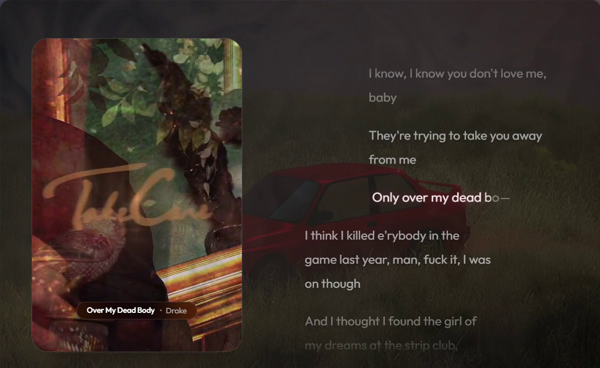
</p>

---

### 2. Windows Taskbar Mode
An ultra-compact, frosted glass ribbon docked directly onto the Windows taskbar. Follow along with syllable-accurate lyric progress and control playback while keeping your entire desktop free for work or games.

<p align="center">
  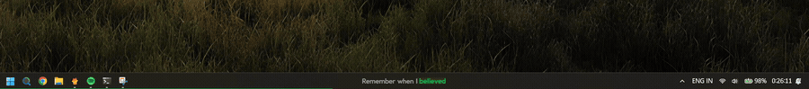
</p>
<p align="center">
  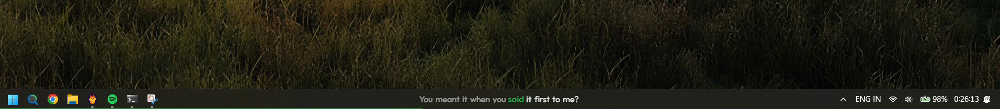
</p>

---

### 3. Dynamic Island
An interactive floating capsule inspired by mobile dynamic islands. Features real-time audio spectrum waves, smooth progress scrubbing, one-click translations, and next-track previews in an elegant micro-HUD.

<p align="center">
  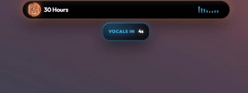
</p>

---

### 4. Cinematic & Kinetic Typography
Turn any song into a stylized music video. Generates procedural kinetic typography motifs, ambient camera motion, and audio-reactive particle fields that bring every lyric to life in full screen.

<p align="center">
  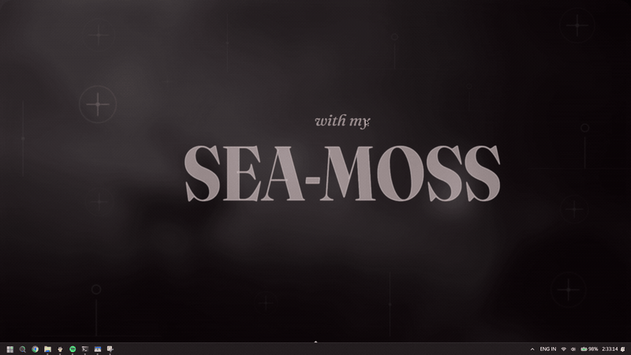
</p>
<p align="center">
  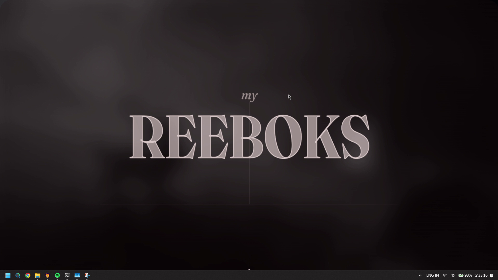
</p>

---

### 5. Ambient Desktop Wallpaper Mode
Transforms your entire desktop into an audio-reactive visualizer. Blends extracted album artwork palette colors into smooth WebGL fluid mesh gradients while keeping lyrics readable over your workflow.

<p align="center">
  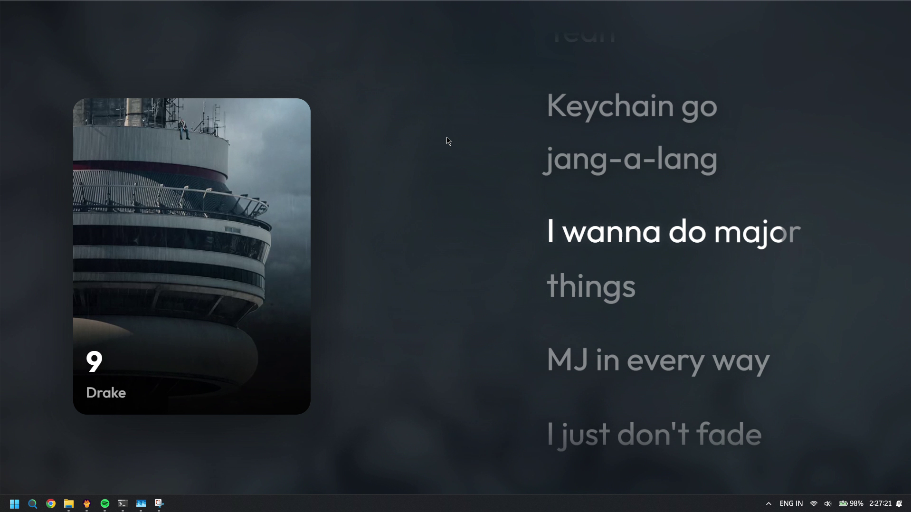
</p>

---

## Built-In Onboarding & Personalization

LyricFlow includes a guided setup wizard to help you select your preferred display mode, connect your preferred music players, and fine-tune appearance settings.

<p align="center">
  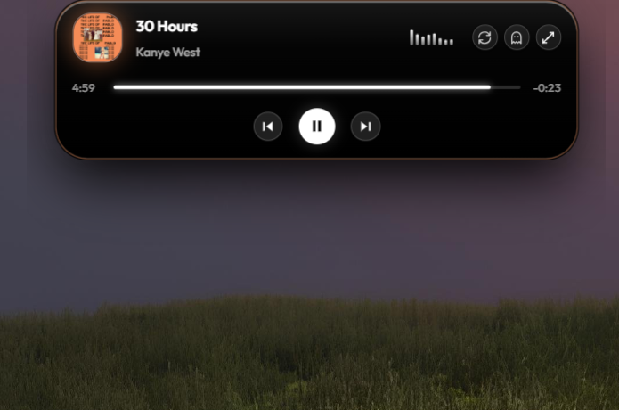
</p>

### Appearance & Visual Customization
* **Themes**: Dark Glass, Deep OLED Black, and Pearl Light modes.
* **Typography**: Custom fonts, adjustable line spacing, letter tracking, and text alignments (Left, Center, Right).
* **Color Extraction**: Algorithmic palette generator dynamically tunes highlights, glow intensity, and background meshes to each album's art.
* **Performance Tuning**: Three-phase CPU reduction, GPU compositor layer containment, and zero-overhead idle defrosting guarantee lightweight operation under 1% CPU.

<p align="center">
  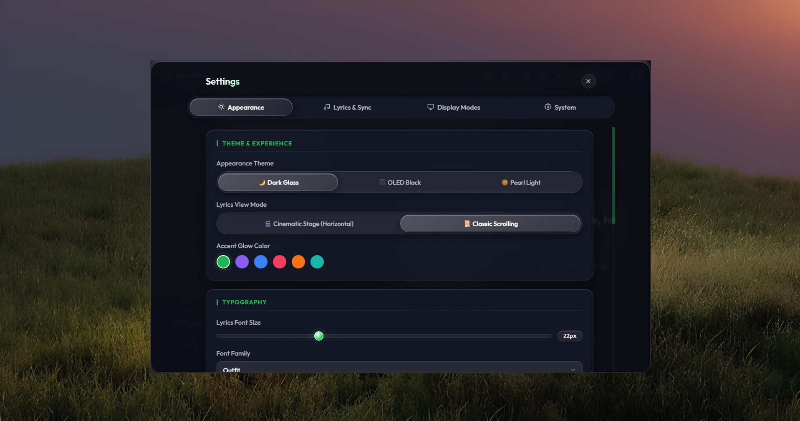
</p>

---

## Lyrics Synchronization Waterfall

LyricFlow arbitrates multiple lyric providers concurrently to find the highest-quality candidate:

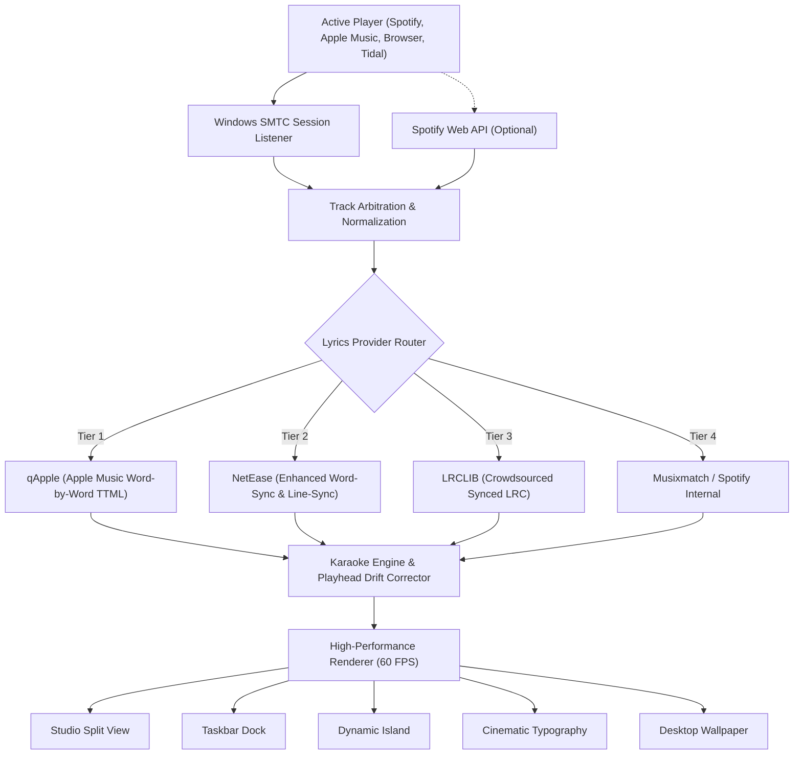

---

## Installation & Getting Started

### 1. Download Installer (Recommended)
Download the newest release for your system from [GitHub Releases](https://github.com/badghost001/LyricFlow/releases/latest):
* **Windows:** `LyricFlow-Setup-1.50.0.exe` (NSIS Installer) or portable standalone build.
* **macOS:** Universal `.dmg` (Apple Silicon & Intel).
* **Linux:** `.AppImage` or `.deb` packages.

### 2. Fast Install via PowerShell (Windows)
Run in PowerShell to automatically install or update the latest Windows release:
```powershell
irm https://raw.githubusercontent.com/badghost001/LyricFlow/main/install.ps1 | iex
```

### 3. Winget (Windows Package Manager)
```powershell
winget install --id badghost.LyricFlow --exact
```

---

## Global Keyboard Shortcuts

| Shortcut | Action |
| :--- | :--- |
| `Ctrl + Shift + C` | Toggle Cinematic / Fullscreen Mode |
| `Ctrl + Shift + B` | Toggle Windows Taskbar Dock |
| `Ctrl + Shift + D` | Toggle Dynamic Island Capsule |
| `Ctrl + Shift + W` | Toggle Desktop Wallpaper Mode |
| `Ctrl + Shift + S` | Open Share Card Studio |
| `Ctrl + Alt + Space` | Play / Pause Current Track |
| `Ctrl + Alt + Left` / `Right` | Previous / Next Track |
| `Ctrl + Alt + C` | Copy Active Lyric Line |

*All shortcuts can be remapped or customized inside Settings.*

---

## Building from Source

### Prerequisites
* **Node.js**: 20 or newer
* **Rust**: Stable toolchain (`rustup`)
* **Platform Build Tools**:
  * Windows: Visual Studio C++ Build Tools & WebView2
  * macOS: Xcode Command Line Tools
  * Linux: WebKitGTK 4.1, AppIndicator, librsvg, patchelf

### Build Instructions
```bash
# Clone the repository
git clone https://github.com/badghost001/LyricFlow.git
cd LyricFlow

# Install dependencies
npm install

# Run in development mode
npm run tauri:dev

# Build standalone distribution package
npm run tauri:build
```

---

## License

Copyright © 2026 badghost. All rights reserved.
Proprietary software distributed for personal entertainment and non-commercial use.
