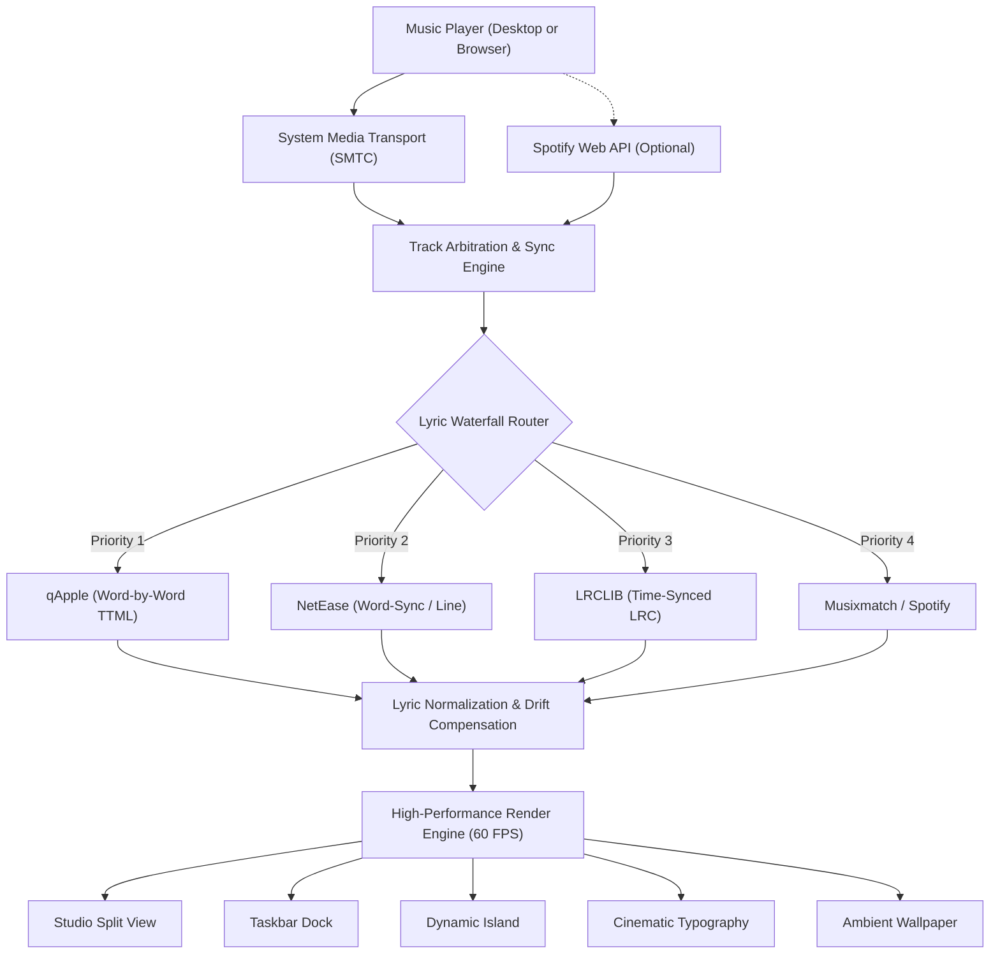

<p align="center">
  
</p>

<h1 align="center">LyricFlow</h1>

<p align="center">
  <strong>Next-Generation Live Desktop Lyrics & Music Companion with Syllable & Word-by-Word Synchronization</strong>
</p>

<p align="center">
  <a href="https://github.com/badghost001/LyricFlow/releases/latest"></a>
  
  
  
  
</p>

<p align="center">
  
</p>

---

## What's New in v1.50.0

LyricFlow **v1.50.0** introduces a ground-up redesign of the core desktop experience, major performance breakthroughs, and next-generation lyrics synchronization:

* 🎨 **Redesigned Studio Split View**: Left-hand side displays responsive album artwork with Apple Motion Art, ambient background glow, song details, and audio visualizer; right-hand side delivers ultra-smooth, word-by-word synchronized lyrics scrolling.
* 📌 **Windows Taskbar Mode**: Seamlessly docks a minimal frosted glass lyric ribbon directly onto the Windows taskbar, featuring live word-by-word progress, scrubber seeking, and quick playback controls without taking up screen real estate.
* 🎬 **Cinematic & Kinetic Modes**: Dynamic typography choreography and audio-reactive generative visualizers transform every track into an immersive music-video experience.
* ⚡ **Redeveloped Word-by-Word Engine**: Rebuilt from scratch with sub-millisecond cadence interpolation, intelligent playhead drift correction, and automated timing normalization.
* 🍏 **Reliable qApple Integration**: Priority high-fidelity word-by-word lyrics from Apple Music with automated multi-mirror failover and cache resilience.
* 🪄 **Animated Artworks (Apple Motion Art)**: Hardware-accelerated decoding and smooth playback of official animated album artworks for supported releases.
* 🚀 **Massive Performance Optimizations**: 3-Phase CPU reduction, GPU compositor layer containment, background defrost throttling, and sub-16ms layout frame rates.
* 💡 **Genius Annotations & Fact Cards**: Contextual in-line annotations and crowdsourced lyrical interpretations right beside active lyric lines.

---

## Display Modes

LyricFlow adapts to your desktop workflow with five dedicated display modes:

| Mode | Preview | Description |
| :--- | :--- | :--- |
| **Studio Split View** *(Redesigned Main UI)* |  | Elegant dual-pane layout featuring adaptive tall album artwork, dynamic track metadata, and real-time word-by-word lyrics. |
| **Taskbar Mode** |  | Ultra-compact glass ribbon anchored directly above the Windows taskbar with live syllable progress and media controls. |
| **Dynamic Island** |  | Floating Apple-style interactive pill capsule with audio-reactive visualizers, gesture scrubbing, and next-up previews. |
| **Cinematic Mode** |  | Fullscreen kinetic typography presentation with procedural visual motifs and fluid color choreography. |
| **Wallpaper Mode** |  | Ambient full-screen desktop backdrop with reactive fluid mesh color gradients and smooth lyrics overlay. |

---

## Core Capabilities

### 🎤 Synchronized Lyrics & Intelligence
* **Multi-Tier Waterfall**: Seamlessly aggregates and arbitrates across **qApple (Apple Music Word-by-Word)**, **NetEase (Enhanced Word-by-Word & Line-Sync)**, **LRCLIB**, **Musixmatch**, and **Spotify**.
* **Syllable-Level Accuracy**: Highlights each word and syllable in real time along with the artist's vocal delivery.
* **Duet & Backing Vocal Separation**: Automatic vocal role detection distinguishing primary and guest singers, backing vocals, and vocal harmonies.
* **Real-Time Bilingual Translation**: Toggle inline translations or display them inside the dedicated Dynamic Island translation capsule.
* **Instant Candidate Cycling**: Quickly search, reload, or cycle between alternative lyric candidates and sources.

### 🎧 Media Integration & Ambient Experience
* **Windows SMTC Detection**: Works out-of-the-box with Windows System Media Transport Controls (Spotify, Apple Music, Tidal, Amazon Music, Chrome, Edge, Brave, YouTube).
* **Optional Spotify Connect**: Direct account linking for advanced track identification, Spotify Canvas, and playback synchronization.
* **Animated Artworks**: Supports official animated cover art with fluid looping and low-power hardware acceleration.
* **Ambient Color Mesh**: Algorithmic color extraction builds matching dynamic gradient themes for every track.
* **Share Card Studio**: Design and export customizable lyric quote cards and animated kinetic clips.

---

## Getting Started

### 1. Download Installer (Recommended)
Download the latest standalone setup for your operating system from [GitHub Releases](https://github.com/badghost001/LyricFlow/releases/latest):
* **Windows:** `LyricFlow-Setup-1.50.0.exe` (NSIS Installer) or portable binary.
* **macOS:** Universal `.dmg` (Apple Silicon & Intel).
* **Linux:** `.AppImage` or `.deb` package.

### 2. Fast Install via PowerShell (Windows)
Install or update directly from PowerShell:
```powershell
irm https://raw.githubusercontent.com/badghost001/LyricFlow/main/install.ps1 | iex
```

### 3. Winget (Windows Package Manager)
```powershell
winget install --id badghost.LyricFlow --exact
```

---

## Keyboard Shortcuts

| Shortcut | Action |
| :--- | :--- |
| `Ctrl + Shift + C` | Toggle Cinematic / Fullscreen Mode |
| `Ctrl + Shift + B` | Toggle Windows Taskbar Mode |
| `Ctrl + Shift + D` | Toggle Dynamic Island Capsule |
| `Ctrl + Shift + W` | Toggle Desktop Wallpaper Mode |
| `Ctrl + Shift + S` | Open Lyric Share Card Studio |
| `Ctrl + Alt + Space` | Play / Pause Playback |
| `Ctrl + Alt + Left` / `Right` | Previous / Next Track |
| `Ctrl + Alt + C` | Copy Currently Active Lyric Line |

*Shortcuts and key combinations can be customized inside Settings.*

---

## System Architecture



---

## Building from Source

### Prerequisites
* **Node.js**: 20+ and npm
* **Rust**: Stable toolchain (`rustup`)
* **Platform Dependencies**:
  * Windows: Visual Studio C++ Build Tools & WebView2
  * macOS: Xcode Command Line Tools
  * Linux: WebKitGTK 4.1, AppIndicator, librsvg

### Build Instructions
```bash
# Clone the repository
git clone https://github.com/badghost001/LyricFlow.git
cd LyricFlow

# Install dependencies
npm install

# Run in development mode
npm run tauri:dev

# Build distributable release package
npm run tauri:build
```

---

## License

Copyright © 2026 badghost. All rights reserved.
Proprietary software distributed for personal entertainment and non-commercial use.
